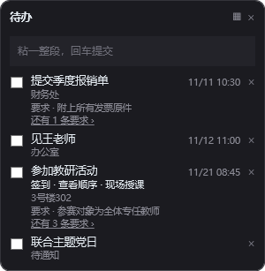
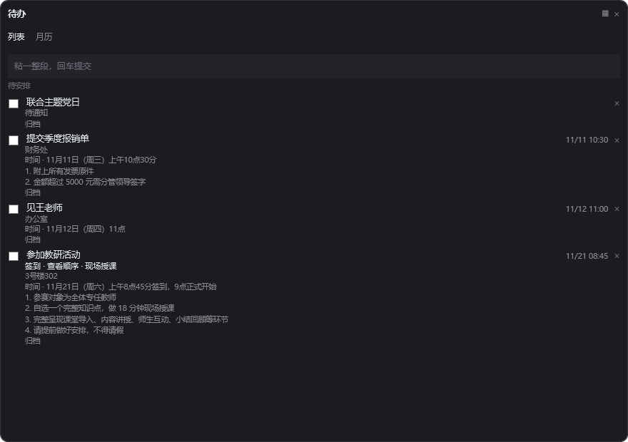
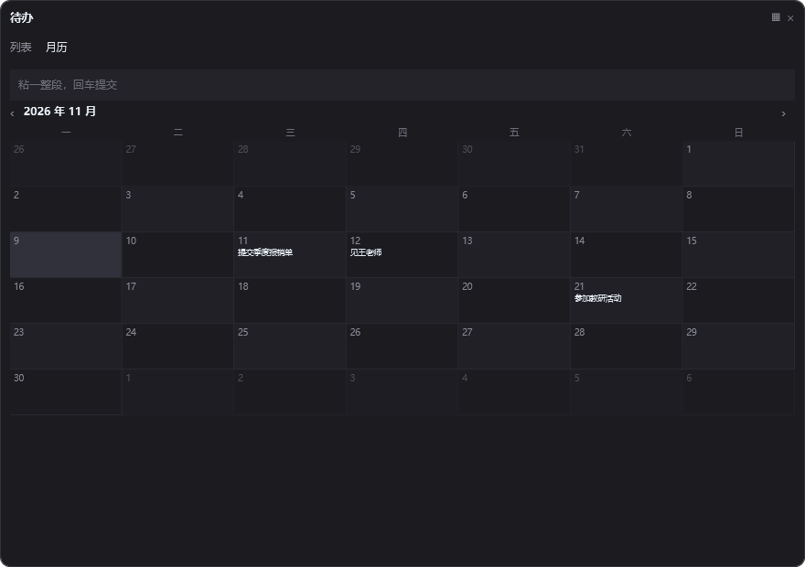

# Ivan-nb
# dsh-todo-note

贴在 Windows 桌面上的待办便签。粘一段话进去，回车，它自己拆成几条待办，把时间、地点、事项和「要求」都填好。

拆句用的是你 DSH 里已经配好的模型——不用再开一个 API key，也不用把文字发给别的地方。

> A sticky-note style todo app for Windows. Paste a paragraph, press Enter, and it splits into todos with time, place, actions and requirements. Parsing is done by the model already configured in your DeepSeek Harness.



## 长什么样

折叠态就是一张 300 宽的小卡片，一直在桌面，不用点开：

- 顶部一个输入框，粘一整段，回车提交；
- 下面是没做完的待办，按时间排，最多 6 条，多了显示「还有 N 条」；
- 勾选框 = 做完（灰掉划线沉底），右边的 `×` = 删掉；
- 「要求 · …」和「还有 N 条要求」可以点开看全部。

点右上角 ▦ 展开成大面板，里面「列表 / 月历」两个视图：





## 它是怎么工作的

卡片是个独立的 `PowerShell + WPF` 进程，和 DSH 没有进程关系：

```
卡片 ──写 request.json──▶ 数据目录 ◀──读── DSH 宿主（调模型拆句）
卡片 ◀──读 result.json─── 数据目录 ◀──写── DSH 宿主
```

- 两边各写各的文件，谁也不改对方的东西，所以不用加锁；
- **DSH 没开也能记待办**，只是拆不了：文字先排队，等 DSH 起来会自动补拆；
- 待办本体存在 `todos.json`，是普通 JSON，别的程序也能读。

## 前提

- Windows 10 / 11
- PowerShell 5.1（系统自带）
- 装好 DeepSeek Harness，并且配过一个模型（`agentDefaultModel` 能取到就行）

## 安装

**1. 装插件本体**

```bash
dsh plugin --profile <你的 profile> add git+https://github.com/Ivan-unb/Ivan-nb.git
```

然后重启 DSH —— 宿主半边不热更新。

**2. 装桌面卡片**

```powershell
powershell -ExecutionPolicy Bypass -File install.ps1
```

它会注册一个登录时自动运行的计划任务，在桌面放一个快捷方式，并立刻把卡片拉起来。重复运行是安全的。

> 为什么用计划任务：从别的进程里拉起的窗口会被那个进程的作业对象绑住，DSH 一关就跟着被回收。计划任务由 Task Scheduler 拉起，和 DSH 无关。

## 用法

| 想做什么 | 怎么做                                                    |
| ---- | ------------------------------------------------------ |
| 加一条  | 粘一整段，回车；确认条里勾选要哪几条、改错字，保存                              |
| 做完   | 点左边勾选框，条目变灰划线并沉底                                       |
| 删掉   | 点最右边的 `×`                                              |
| 改标题  | 在展开的列表里点标题就地改，回车或点别处保存                                 |
| 换位置  | 拖标题栏，位置会记住                                             |
| 换配色  | 右键 → 背景色 → 挑一套（carbon / ocean / forest / dusk / paper） |
| 导出   | 右键 → 导出，存成 JSON                                        |
| 看月历  | 点 ▦ 展开，切到「月历」，点某天看当天安排，也能在那天直接加一条                      |

提交后先出确认条，**点保存才落库**——拆错了就在这一步取消掉，不会污染列表。

## 数据在哪

默认 `%USERPROFILE%\.dsh\todo-note\`，如果设了 `DSH_HOME` 就用 `%DSH_HOME%\todo-note\`：

| 文件                             | 内容            |
| ------------------------------ | ------------- |
| `todos.json`                   | 待办本体          |
| `window.json`                  | 窗口位置、配色       |
| `request.json` / `result.json` | 卡片和 DSH 之间的交接 |
| `run.log` / `diag.log`         | 出问题先看这两个      |

## 隐私

- 待办只存在本机这个文件夹里，没有账号，没有云端；
